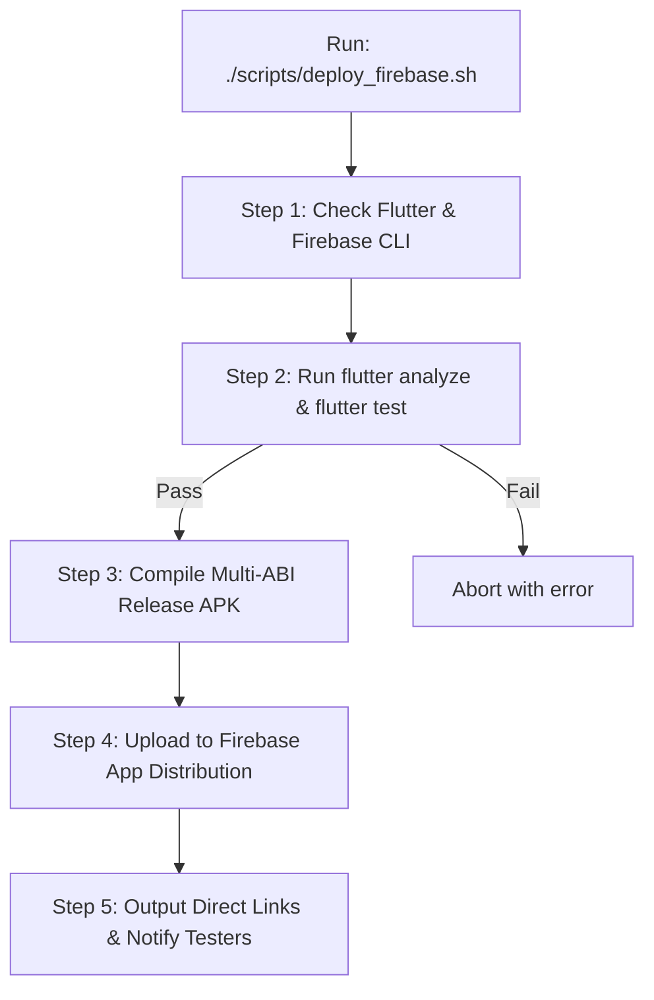

# 📦 Firebase App Distribution & Local Automation Guide

This guide documents the complete Firebase setup, 1-click deployment automation script, and tester onboarding workflow for **ReelsGuard**.

---

## 1. Project & Application Metadata

| Property | Value | Notes |
| :--- | :--- | :--- |
| **Firebase Project Name** | `ReelsGuard` | Registered in Google Cloud & Firebase |
| **Firebase Project ID** | `reelsguard-shield-2026` | Set in [`.firebaserc`](../.firebaserc) as default |
| **Android App ID** | `1:1039029012352:android:46965fd309e781c6522365` | Target application ID in Firebase |
| **Package Name** | `com.antidoomscroll.reels.reels_count` | Android `applicationId` in Gradle |
| **Firebase Config File** | [`android/app/google-services.json`](../android/app/google-services.json) | Secure client credential file |
| **CLI Target Config** | [`firebase.json`](../firebase.json) | Local Firebase CLI mapping |
| **Local Deploy Script** | [`scripts/deploy_firebase.sh`](../scripts/deploy_firebase.sh) | 1-Click build & upload automation |

---

## 2. Key URLs & Consoles

* **Firebase Console (Releases Dashboard)**:  
  [https://console.firebase.google.com/project/reelsguard-shield-2026/appdistribution/app/android:com.antidoomscroll.reels.reels_count/releases](https://console.firebase.google.com/project/reelsguard-shield-2026/appdistribution/app/android:com.antidoomscroll.reels.reels_count/releases)

* **Testers & Groups Console**:  
  [https://console.firebase.google.com/project/reelsguard-shield-2026/appdistribution/app/android:com.antidoomscroll.reels.reels_count/testers](https://console.firebase.google.com/project/reelsguard-shield-2026/appdistribution/app/android:com.antidoomscroll.reels.reels_count/testers)

* **Tester App Portal (Invited Testers View)**:  
  [https://appdistribution.firebase.google.com/testerapps/1:1039029012352:android:46965fd309e781c6522365](https://appdistribution.firebase.google.com/testerapps/1:1039029012352:android:46965fd309e781c6522365)

---

## 3. How the 1-Click Deploy Automation Works

The automation script [`scripts/deploy_firebase.sh`](../scripts/deploy_firebase.sh) executes the complete build, test, and release cycle in one command:



### Usage Examples:

```bash
# 1. Standard deployment with timestamped release notes
./scripts/deploy_firebase.sh

# 2. Deploy with custom release notes
./scripts/deploy_firebase.sh "Updated mindful break dialog and hydration tracker"

# 3. Deploy and distribute to a specific tester group
./scripts/deploy_firebase.sh "Sprint 2 Beta" "beta-testers"

# 4. Deploy and distribute directly to tester email addresses
./scripts/deploy_firebase.sh "Release candidate 1" "tester1@example.com,tester2@example.com"
```

---

## 4. How to Manage Testers & Share the App

There are two primary ways to distribute your build to testers:

### Method A: Invite Links (Recommended for Quick Onboarding)
1. Open the [Firebase App Distribution Invite Links Tab](https://console.firebase.google.com/project/reelsguard-shield-2026/appdistribution/app/android:com.antidoomscroll.reels.reels_count/invitation-links).
2. Click **Create invite link**.
3. Choose a group (e.g. `General Testers` or create a new group).
4. Copy the generated invite link (e.g. `https://appdistribution.firebase.google.com/i/...`) and send it via Slack, WhatsApp, or Email.
5. Testers click the link on their phone and accept the invite once. Any future releases distributed to that group will automatically notify them.

### Method B: Email Direct Invites
1. Open the [Firebase Testers & Groups Tab](https://console.firebase.google.com/project/reelsguard-shield-2026/appdistribution/app/android:com.antidoomscroll.reels.reels_count/testers).
2. Click **Add testers** and enter email addresses (e.g. `user@gmail.com`).
3. Or group them under a group name like `internal-team` or `beta-testers`.
4. Firebase sends an official email invitation with an **"Accept Invitation"** button.

---

## 5. Physical Android Device Installation Guide (For Testers)

Share these instructions with your physical device testers:

1. **Accept the Invite**:
   - Open the invitation email or tap the Invite Link on your Android device.
   - Sign in with your Google account.
2. **Download App Tester or APK**:
   - Tap **Download** to download `app-release.apk`.
   - Optionally install **App Tester** from Firebase to receive automatic in-app update prompts for subsequent builds.
3. **Allow Unknown Sources (First-time installation)**:
   - When prompted by Android (*"For your security, your phone is not allowed to install unknown apps from this source"*):
     - Tap **Settings** in the prompt.
     - Toggle on **"Allow from this source"**.
     - Press back and tap **Install**.
4. **App Launch & Permissions Setup**:
   - Open **ReelsGuard**.
   - Navigate to the **Setup** tab (rightmost tab on the bottom dock).
   - Tap **Review & Enable** for **Accessibility Service** and **Usage Access**.
   - Review the Google Play Prominent In-App Disclosure and toggle on the permission in Android Settings.
   - If on Android 13/14 and Accessibility says *"Restricted setting"*:
     - Go to Android Settings $\rightarrow$ Apps $\rightarrow$ ReelsGuard $\rightarrow$ tap the top-right 3 dots (⋮) $\rightarrow$ select **"Allow restricted settings"**, authenticate with fingerprint/PIN, then return and enable Accessibility.

---

## 6. Architecture & Integration Details

### Native Android Integration
- **`com.google.gms.google-services`**: Applied in [`android/settings.gradle.kts`](../android/settings.gradle.kts) and [`android/app/build.gradle.kts`](../android/app/build.gradle.kts).
- **`google-services.json`**: Placed in [`android/app/google-services.json`](../android/app/google-services.json).

### Flutter Integration
- **`firebase_core: ^5.0.0`**: Registered in [`pubspec.yaml`](../pubspec.yaml).
- **`Firebase.initializeApp()`**: Safely initialized with try/catch error shielding in [`lib/main.dart`](../lib/main.dart), ensuring that unit tests and mock environments continue to run without requiring native Firebase stubs.

---

## 7. Troubleshooting & FAQs

* **Q: The deploy script fails with "firebase: command not found".**  
  **A:** Install the Firebase CLI globally via npm:
  ```bash
  npm install -g firebase-tools
  firebase login
  ```

* **Q: How do I test the app on my local emulator or USB-connected phone without uploading?**  
  **A:** Run directly via Flutter:
  ```bash
  flutter run --release
  ```

* **Q: Can I update the release notes after uploading?**  
  **A:** Yes. In the [Firebase Console](https://console.firebase.google.com/project/reelsguard-shield-2026/appdistribution/app/android:com.antidoomscroll.reels.reels_count/releases), click the release version, tap the three dots (⋮), and choose **Edit release notes**.
